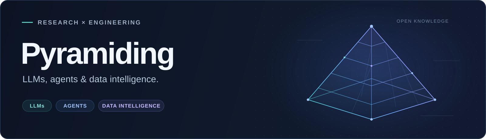
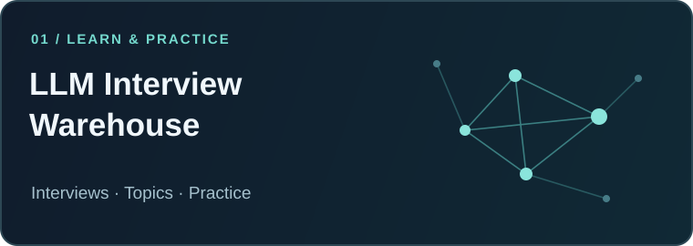
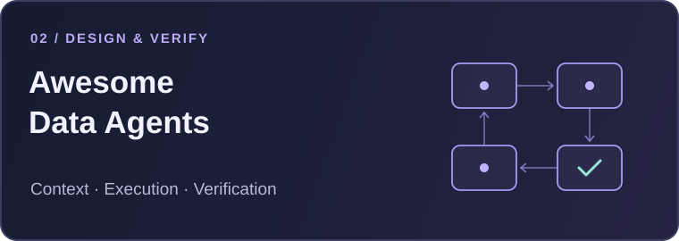

  

  <strong>大模型 · 智能体 · 数据智能</strong> 
  从论文与公开资料出发，把知识整理成可检索、可验证的实践。

  <a href="https://github.com/Pyramiding/llm-interview-warehouse">大模型面经与题解</a>
  &nbsp; / &nbsp;
  <a href="https://github.com/Pyramiding/awesome-data-agents">Data Agent 工程地图</a>
  &nbsp; / &nbsp;
  <a href="https://github.com/Pyramiding?tab=repositories">全部仓库</a>

## 精选项目

<table>
  <tr>
    <td width="50%" valign="top">
      
      
<strong><a href="https://github.com/Pyramiding/llm-interview-warehouse">大模型面经与题解仓库</a></strong>

      
按公司、研究方向和业务场景整理公开面经，配合原创题解、项目深挖与手写练习。

      
<a href="https://github.com/Pyramiding/llm-interview-warehouse/blob/main/docs/interviews/by-company.md">按公司查找</a> · <a href="https://github.com/Pyramiding/llm-interview-warehouse/blob/main/docs/interviews/by-topic.md">按方向查找</a> · <a href="https://github.com/Pyramiding/llm-interview-warehouse/blob/main/docs/interviews/company-direction.md">公司 × 业务</a>

    </td>
    <td width="50%" valign="top">
      
      
<strong><a href="https://github.com/Pyramiding/awesome-data-agents">Data Agent 工程地图</a></strong>

      
从上下文、工具执行到验证与治理，连接 Data Agent 架构、公开实现、论文和评测。

      
<a href="https://github.com/Pyramiding/awesome-data-agents#一眼看懂-data-agent">参考架构</a> · <a href="https://github.com/Pyramiding/awesome-data-agents/blob/main/PROJECT_GUIDE.md">项目路线</a> · <a href="https://github.com/Pyramiding/awesome-data-agents/blob/main/DESIGN_REVIEW.md">设计评审</a>

    </td>
  </tr>
</table>

## 关注方向

| 方向 | 关注的问题 |
| :--- | :--- |
| **LLMs & Agents** | 模型训练与对齐、RAG、工具调用、上下文与记忆、推理服务与评测。 |
| **Data Intelligence** | 数据语义、Text-to-SQL、分析工作流、结果验证与可追溯性。 |
| **AI × 业务场景** | 大模型与搜索、广告、推荐、增长、营销、风控、语音和客服的结合。 |

## 最近整理

- **2026.10.23** · [补充牛客与 LeetCode 面经](https://github.com/Pyramiding/llm-interview-warehouse/blob/main/docs/nowcoder-leetcode-2026-10-23.md)，完善公司、技术方向与业务交叉索引。
- **2026.10.22** · [整理 Data Agent 资料与工程参考](https://github.com/Pyramiding/awesome-data-agents)，连接上下文、执行、验证与治理。

**回到原始来源 → 理解机制与边界 → 组织索引与练习 → 检查与修订。** 欢迎通过项目 Issues 补充资料、纠错或交流。

  
<strong>早期学习与实践</strong> · TensorFlow / C++ / 算法

   

- [Tensorflow Action Recognition](https://github.com/Pyramiding/Tensorflow_action_recognition)：基于 KTH 数据集的动作识别学习实践，涉及 CNN、LSTM、数据处理与模型训练。
- [CodingInterview](https://github.com/Pyramiding/CodingInterview)：C++ 版《剑指 Offer》题解。

  AI sorcerer · Keep learning. Keep building.

